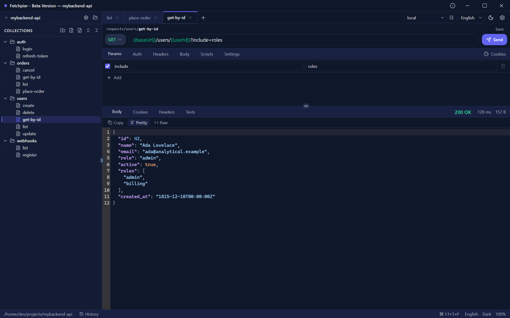
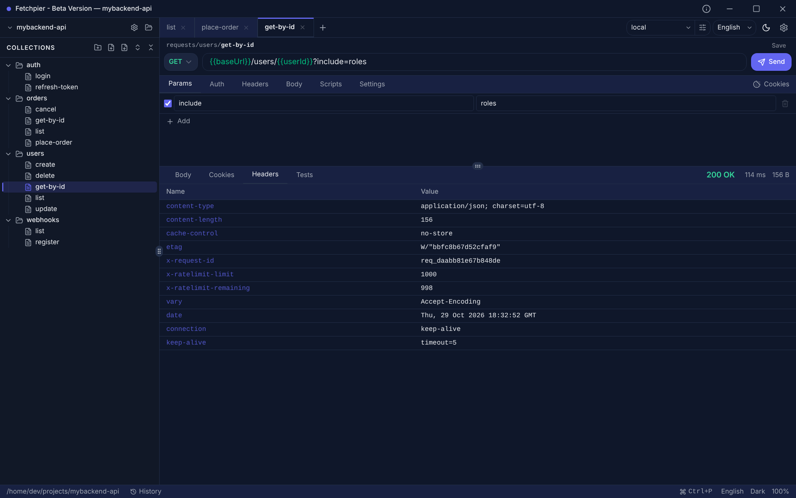
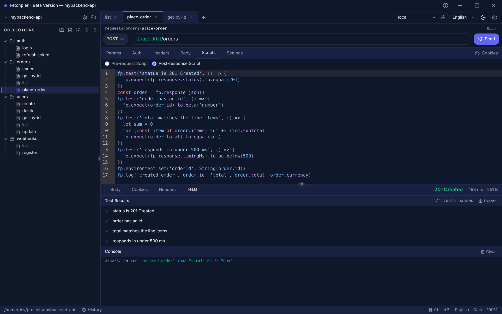

# Fetchpier

A desktop and CI/CD API client with the standard `.http` format, MIT — your files keep working in VS Code even if Fetchpier disappears tomorrow.

[](https://github.com/dmonza/fetchpier/actions/workflows/ci.yml)
[](https://github.com/dmonza/fetchpier/actions/workflows/nightly.yml)
[](LICENSE)

[Download](https://github.com/dmonza/fetchpier/releases) · [Documentation](https://fetchpier.com/docs) · [Sponsor](https://ko-fi.com/dmonza)



---

## What it is

Fetchpier is a desktop application for working with HTTP APIs — sending requests, inspecting responses, organizing collections, scripting tests, and importing API schemas. It runs on Windows, macOS, and Linux.

Three commitments define it:

- **The client is open source under a permissive license, forever.** MIT, all the code, all the features. There is no "Pro", no "Ultimate", no hidden features behind a paywall — and there never will be.
- **Zero lock-in.** Requests are stored as plain `.http` files — the same format VS Code REST Client and JetBrains HTTP Client understand. If you stop using Fetchpier tomorrow, your collections keep working in any modern editor. There's nothing to "export to leave".
- **What gets built, gets built for everyone.** Every feature, fix, and improvement that lands in the client stays available to all users under MIT. No exclusive features for sponsors, no private builds, no tier system on the client.

## Why it exists

Existing API clients pull in opposite directions. Some require cloud accounts and charge per seat. Some are open-source but keep advanced features behind paid plans. Some are excellent but maintained by a single developer with limited scope.

Fetchpier sits in a specific position: open-source under a permissive license, no paid tier of the client ever, format compatibility with tools developers already use. The client is fully free and complete — that's the design, not a strategy.

Development is sustained primarily by sponsorship: Sincrum (my studio) is the main sponsor, and external sponsors via Ko-fi accelerate the pace. Consulting engagements that come up around Fetchpier — migration audits, custom integrations with internal systems — are handled by Sincrum as traditional consulting work, separate from the public product. See [Sponsoring](#sponsoring) below for the full picture.

## Features

**Requests and responses**

- Full HTTP support: methods, headers, query params, path params, body (raw, JSON, urlencoded, binary, multipart/form-data)
- Response viewer with syntax highlighting, headers table, timing, and size
- Variable substitution with `{{var}}` syntax, autocomplete, and inline highlighting
- Cookie jar per environment with manual management (RFC 6265 compliant)



**Collections and workspaces**

- Workspace is a folder; collections are subfolders; requests are `.http` files
- Organize by drag & drop — moves never overwrite an existing file
- Real-time file watching — edit files in any editor and the app updates
- Preview tabs — single-click a request to peek at it in one ephemeral tab; double-click or edit to keep it
- Session restore — your open tabs and active environment come back when you reopen a workspace
- Full Git compatibility for versioning and team collaboration


**Authentication**

- Bearer, Basic, API Key (header or query)
- The selected auth scheme is saved in the `.http` file and restored when you reopen the request
- More auth methods coming (see [Roadmap](#roadmap))

**Environments and variables**

- Multiple environments per workspace, switchable instantly
- Variables with live resolution feedback
- Environment files are plain JSON, Git-friendly
- `{{$env.NAME}}` references in variable values resolve from a workspace `.env` (gitignored by default) or the host shell, so secrets stay out of the repo
- **Secret variables**: encrypt credentials in place (XChaCha20-Poly1305) with a per-workspace key so the ciphertext is safely committable and shared through Git; masked everywhere Fetchpier writes (activity log, reporters), revealed on demand (Touch ID-gated on macOS), with one-key backup and rotation. The CLI resolves them from `FETCHPIER_WORKSPACE_KEY`.
- **Workspace keys management**: a settings tab lists the workspace keys held on this machine (metadata only — never revealing the key), shows whether each is still referenced by a known workspace, and lets you delete stale keys or paste a key ahead of cloning its workspace.
- **Local value overrides**: a per-machine, never-shared layer (shown as a Shared | Local two-column editor) holds personal credentials and script-written values without dirtying the committed team file. A per-variable **Sync** check shows whether each value follows the team or you have diverged — unchecking creates a personal override, re-checking returns it to the shared value. `fp.environment.set()` persists here across restarts; secret-named local values are encrypted like the shared ones, re-wrapped automatically on key rotation. The CLI applies them read-only.

**Scripting and testing**

- Pre-request and post-response scripts in JavaScript
- Sandboxed execution (`node:vm`-based, synchronous contract, hardened against async APIs)
- Built-in assertion library (`fp.expect(...).to...`)
- Test results panel with pass/fail badges and console output



**Security posture for enterprise environments**

- **Dual TLS scoping**: workspace-scope (`.fetchpier/certs/`, travels with Git like `.vscode/`) plus app-scope global. The bundled CA set deliberately ignores the OS trust store — corporate CAs are imported explicitly, which makes MITM proxy environments work predictably instead of failing in mysterious ways.
- **Authorization-stripping on cross-host redirects** by default. Opt back in only when you actually need it.
- **Sandbox with regression tests** that verify isolation against `Promise`, `setTimeout`, `SharedArrayBuffer`, `Atomics`, `WebAssembly`, `eval`, `new Function` and host-realm escapes via constructor chains.
- **OS-level renderer sandbox**: the UI process runs as a pure Chromium process inside the operating system sandbox (no Node runtime, no arbitrary syscalls), with a regression test pinning the setting on. Privileged work happens only in the main process, behind validated IPC that answers only the app's own documents. The UI is refused every browser permission except the clipboard (no notifications, camera, microphone, location or device access), and a Content-Security-Policy refuses inline scripts and `eval`. Release binaries ship with hardened Electron fuses: they cannot be run as a plain Node.js runtime, ignore `NODE_OPTIONS` and debugger flags, and load only an integrity-checked application archive.
- **Declared network egress**: Fetchpier opens exactly one connection on its own account — the version check you trigger yourself from the updates panel, an HTTPS `GET` to `https://public.sincrum.com/products.json`. There is no check at startup and nothing runs in the background. Every other connection originates from your request configuration. No telemetry, no remote content in the UI (no web fonts, CDN scripts, or remote images). The renderer and preload boundary is enforced by lint, a build-time bundle audit, an end-to-end test, and a runtime Content-Security-Policy plus navigation guard that block off-origin connections and remote navigation outright — not just stated.

**Schema importing**

- OpenAPI 2.x / 3.x including Swagger (JSON and YAML)
- GraphQL SDL and introspection
- WSDL / SOAP (operations get a ready-to-edit envelope with a sample body generated from the schema)
- Postman collections (v2.0 and v2.1)

**Quality of life**

- Light and dark themes, OS-aware
- Internationalization (English and Spanish) from day one
- Keyboard shortcuts and command palette
- Detachable Activity panel (history and run output) in its own window
- On-demand version check — tells you when a newer release is out and links to the [GitHub Releases](https://github.com/dmonza/fetchpier/releases) page; it never downloads or installs anything by itself

## Install

### Pre-built binaries

Download the installer for Windows, macOS, or Linux from [GitHub Releases](https://github.com/dmonza/fetchpier/releases).

The installers are not code-signed yet, so Windows SmartScreen and macOS Gatekeeper show a warning on first launch. The [installation guide](https://fetchpier.com/docs/getting-started/installation/) explains how to get past each one.

### From source

```bash
git clone https://github.com/dmonza/fetchpier.git
cd fetchpier
npm install
npm run dev
```

Requires Node.js 22.19 or later.

## Workspace structure

A Fetchpier workspace is a regular folder. Open any folder, and the app sets up a small structure for you. Two organising rules keep it tidy:

- **Top-level folders are your artefacts** — `requests/` for the `.http` tree, `environments/` for each environment's config, and (in the future) `mocks/` and `flows/`. These are what you author, share, and commit to Git.
- **`.fetchpier/` and `.state/` / `.runs/` are app state** — workspace settings, per-environment cookies, and per-send activity logs. Safe to `.gitignore` (a sensible default is created on first open).

```
my-api-tests/
├── .fetchpier/
│   ├── settings.json                       # workspace-level HTTP defaults (shared)
│   └── .state/workspace-state.json         # open-tab session + active environment (personal)
├── environments/
│   ├── development/
│   │   ├── config.json                     # { id, name, variables }
│   │   └── .state/cookies.json             # cookie jar (scoped to this env)
│   └── production/
│       ├── config.json
│       └── .state/cookies.json
└── requests/
    ├── .runs/                              # one .http per send (activity log)
    ├── .state/ui-state.json                # per-request UI state (last-active sub-tabs)
    ├── .state/tree-state.json              # sidebar tree expansion (which folders are open)
    ├── auth/
    │   ├── login.http
    │   └── refresh-token.http
    └── users/
        ├── list-users.http
        └── get-user.http
```

Commit the folder to Git. Share it with your team. Open it in another editor. It is your data.

## Command-line interface

Fetchpier has a companion CLI, **`fp`**, for running requests and inspecting environments from a terminal or CI pipeline. It runs the same engine as the desktop app — same variables, auth, cookies, scripts, and tests — so a request behaves identically whether you send it from the UI or the command line.

```bash
npm install -g @fetchpier/cli

fp init my-api                                # scaffold a new workspace
cd my-api
fp run                                        # run every request under requests/
fp run requests/auth/login.http               # run one request
fp run requests/auth --env staging            # run a folder against an environment
fp run --reporter-junit out.xml               # emit a JUnit report for CI
fp env list                                   # list environments
```

It is installed separately from the desktop app and supports CLI, JSON, JUnit, and HTML reports plus distinct exit codes per outcome for CI. Full command and flag reference: [`packages/fetchpier-cli/README.md`](packages/fetchpier-cli/README.md).

## Agentic engineering, not vibe coding

Fetchpier is developed by directing [Claude Code](https://www.anthropic.com/claude-code) under a requirements-first process: every change starts from a written requirement and an implementation plan, and lands only through the verification gate described below. This is a deliberate choice and a public bet: that a senior engineer working with AI as a serious collaborator, under disciplined process and verifiable artifacts, can produce production-quality software at a pace that was not previously possible.

The requirements and plans are internal working documents and are not published at this stage. Code comments and test names cite them by identifier (`REQ-NNNN`, `CA-NN`); read those as traceability labels. What you can audit in this repository is the code and the gates that guard it:

- **Regression tests that verify the sandbox isolation contract** — see `packages/fetchpier-core/src/scripting/fp-sandbox.isolation.test.ts`. The suite includes a recursive walk that fails fast if a future change accidentally widens the surface (async APIs, code generation, host-realm constructor chains).
- **Invariants enforced by tooling, not by convention.** The rule that the UI never opens a network connection is checked three times: by lint at source time (`eslint.config.mjs`), by a bundle audit at build time (`scripts/audit/network-egress-bundle.mjs`), and by an end-to-end test at runtime (`test/e2e/network-egress.spec.ts`). Atomic file writes and the startup cold path are guarded the same way (`scripts/audit/`).
- **A local verification gate before every commit** (`npm run post-req`, extended by `npm run preflight` before releases): typecheck, lint, the full test suite with non-regressive coverage, a `fp-api.d.ts` codegen drift check, and end-to-end smoke tests — plus dependency audit and license generation at release time. Code that doesn't pass the gate doesn't get committed.

Andrej Karpathy proposed the term "agentic engineering" in early 2026 and later expanded on it at Sequoia's AI Ascent; it's the term I prefer over plain "built with AI". The code is auditable, and so are the gates that guard it.

### A note on the sandbox threat model

Scripts in Fetchpier are authored by the user who owns the workspace — the same trust model as Postman, Bruno, JetBrains HTTP Client, or VS Code REST Client. The sandbox protects against _accidental_ surface leaks and keeps the exposed API small enough to audit; it is **not** a security boundary against deliberately malicious scripts, and `node:vm` is documented by Node itself as unsafe for running untrusted code. Treat a `.http` file from an unfamiliar source the same way you'd treat a shell script from one. What does and does not count as a sandbox vulnerability is spelled out in [`SECURITY.md`](SECURITY.md).

## Roadmap

The current development priorities, in approximate order:

1. **OAuth2** — Authorization Code, Client Credentials, refresh tokens. (The most requested gap in the ecosystem right now.)
2. **Local mock server** — built into the client, free, no separate service required for local use.
3. **Real-time protocols** — WebSocket, Server-Sent Events, gRPC.
4. **API documentation export** — generate static HTML or Markdown docs from collections.
5. **mTLS / client-certificate workflows** — client-certificate authentication for fintech and enterprise integrations.

Things explicitly not on the roadmap:

- **Cloud sync across devices.** Git is the sync. This is a permanent design choice.
- **A paid tier of the client.** The client is free and complete under MIT. This is non-negotiable and permanent — see the three commitments at the top of this README.

Optional online services (hosted webhook receiver, shared mock servers, contract testing in cron, hosted docs) are a hypothesis to evaluate over time, not a roadmap commitment. **If any of them ever ships, the client running on your machine stays MIT and complete** — those services would be separate, optional, and priced against actual infrastructure cost, not perceived value.

## Contributing

Bug reports, feature ideas, documentation fixes, and security reports are welcome. Please read [`CONTRIBUTING.md`](CONTRIBUTING.md) first — note that during the current stabilization phase **external pull requests are not being accepted yet**.

For bug reports, use the bug report template. For features, please open a discussion first.

## Sponsoring

If Fetchpier is useful to you and you would like to support its development:

- Star this repository
- Support through [Buy Me a Coffee - Ko-fi](https://ko-fi.com/dmonza)

Sponsorship determines the pace of development, not access to features. The client is free and complete for everyone under MIT regardless of sponsorship — that's the principle. What sponsorship buys is more time dedicated to Fetchpier: more frequent releases, more roadmap items closed, deeper reviews. Sincrum is the main sponsor; external sponsors accelerate everything from there.

### Sponsored features

A company can sponsor the accelerated development of a specific roadmap feature (for example, mTLS workflows for a fintech integration, or specific CI reporters). The arrangement is straightforward:

1. The feature is already on (or fits) the public roadmap.
2. The company sponsors the development of that specific feature at a sum that reflects the estimated effort.
3. **The feature ships as MIT code, available to all users when it merges.**
4. The sponsor gets prioritized scheduling, an optional credit in the changelog and release notes, and a feedback window during development. They do **not** get exclusivity, a private build, or a "Pro" version. Those are not on offer at any price.

### Custom integrations and customizations (Sincrum)

When a company needs Fetchpier to connect with their internal ERP, a custom vault, a non-standard CI pipeline, or any other system that only serves them — that's traditional consulting work handled by [Sincrum](https://sincrum.com). The code for those customizations lives in a private repository, not in the public Fetchpier repo. This is custom development, not a product feature.

The two categories are decided by a single question: _does this serve more people than just the one paying for it?_ If yes → public roadmap, sponsored feature, stays MIT. If no → Sincrum consulting, customer's code.

Sponsorship does not grant any rights to features, prioritization commitments, or trademark use beyond what is described in [`TRADEMARKS.md`](TRADEMARKS.md).

## License

Fetchpier is released under the [MIT License](LICENSE).

Third-party open-source components retain their respective licenses; see [`THIRD_PARTY_LICENSES.txt`](THIRD_PARTY_LICENSES.txt) for attribution.

Branding, names, logos, and visual identity are governed separately by [`TRADEMARKS.md`](TRADEMARKS.md).

## Author

**Daniel Monza** — Senior Developer, Founder of [Sincrum](https://sincrum.com).

Fetchpier is my take on an API client focused on privacy and on collaboration through Git, with no paid or restricted features.

It is also the path I chose to put my own process to the test: building software by directing AI agents, as described in [Agentic engineering, not vibe coding](#agentic-engineering-not-vibe-coding).

Sincrum is a software engineering studio based in Uruguay, through which I build my own products and provide consulting services.

The client's copyright is personal, which keeps the project's continuity independent of any commercial structure; Sincrum is the main sponsor of its development.

- Website: [sincrum.com](https://sincrum.com)
- LinkedIn: [linkedin.com/in/daniel-monza](https://www.linkedin.com/in/daniel-monza)

If Sincrum ever stops operating, Fetchpier doesn't disappear: the client is MIT, the code is public, anyone can continue. Worst case the pace slows down — and the `.http` files you already have keep working in VS Code and JetBrains regardless.

## Security

To report a security vulnerability, please follow the process described in [`SECURITY.md`](SECURITY.md). Do not open public issues for security reports.
